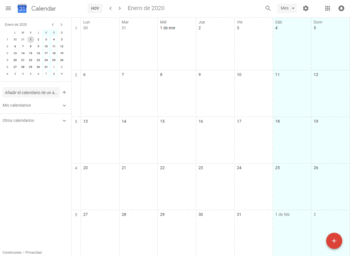

# Colorize Google Calendar Weekends 🎨📅

Un sencillo estilo CSS diseñado para **Stylish** (o cualquier gestor de estilos de usuario como Stylus) que resalta visualmente los fines de semana (sábados y domingos) en **Google Calendar**, facilitando la lectura y planificación semanal o mensual.

## 📸 Vista previa



## ✨ Características

* **Diferenciación visual clara:** Aplica un tono azul claro (`#EEFFFF`) a las columnas correspondientes al sábado y domingo, manteniendo los días laborables en blanco (`#FFFFFF`).
* **Compatible con múltiples vistas:** Funciona tanto en la vista semanal como en la vista mensual y en las cabeceras de los días.
* **Ligero y rápido:** CSS puro sin impacto en el rendimiento del navegador.

> **Nota:** Este script está configurado asumiendo que tu semana en Google Calendar **comienza en lunes** (índices de columna 6 y 7 para sábado y domingo).

## 🚀 Instalación

1. Instala la extensión **Stylish** (o **Stylus**) en tu navegador Chrome.
2. Abre la extensión y selecciona la opción para **crear un nuevo estilo**.
3. Copia el contenido del archivo `colorize_google_weekend_4_stylish.txt` y pégalo en el editor de código.
4. En la sección **"Se aplica a"** (o *Applies to* en la parte inferior), selecciona **URLs que empiezan por** e introduce:
   ```text
   https://calendar.google.com/
   ```
5. Asigna un nombre al estilo (por ejemplo, *Google Calendar Weekends*) y haz clic en **Guardar**.

## 🎨 Personalización

Si deseas cambiar el color de los fines de semana, simplemente busca el código hexadecimal `#EEFFFF` en el archivo CSS y reemplázalo por el color que prefieras (por ejemplo, `#F5F5F5` para un gris suave o `#FFF0F5` para un tono rosado).

```css
/* Ejemplo para cambiar el color del fin de semana */
*[data-column-index="5"],
*[data-column-index="6"] { 
  background-color: #EEFFFF; /* Cambia este código por tu color favorito */
}
```

## 📄 Nota

Este proyecto está obsoleto. Ahora mismo hay extensiones mejores como G-Calize (https://chromewebstore.google.com/detail/g-calize/piiljfhidimfponnkjlkecnpjhdijfde) con mayor configuración y posibilidades.
